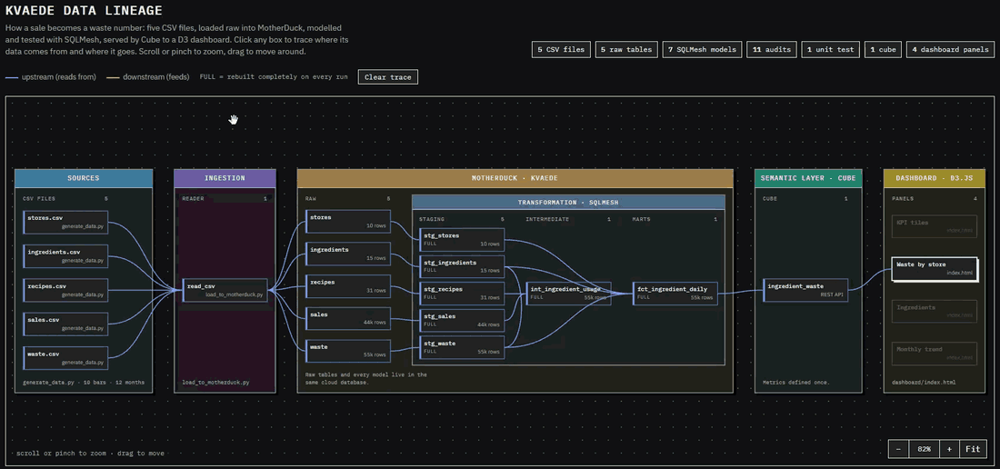
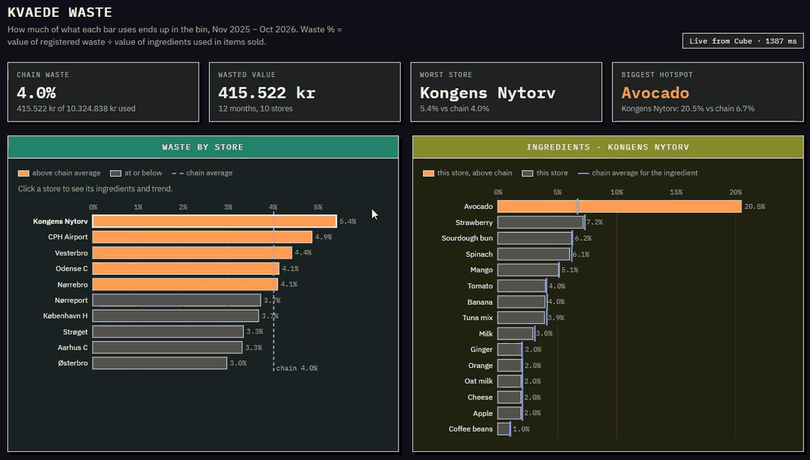

# Kvaede – ingredient waste per store

A small end-to-end data project on a juice bar chain I made up: how much of
what each bar uses ends up in the bin, and where it's worse than the chain
average.

The idea: **items sold × recipe = ingredients used**, compared with the waste
the staff registered, in DKK.

```
generate_data.py → MotherDuck (raw) → SQLMesh (staging → marts) → Cube → D3 dashboard
```

## Steps

**Source data** – `generate_data.py` writes 5 CSVs to `data/`: stores,
ingredients, recipes, daily sales and waste. I planted two things to find:
Kongens Nytorv wastes ~20% of its avocados, and 8% of waste rows are in kg or l
instead of g or ml.

**Storage** – `load_to_motherduck.py` loads the CSVs into MotherDuck (cloud
DuckDB) as `kvaede.raw`, unchanged. Raw stays raw, so everything after it can
be rebuilt at any time.

**Modelling** – SQLMesh builds the models in `transform/` in three layers.
Staging has one model per raw table, and `stg_waste` converts kg and l to g
and ml. `int_ingredient_usage` multiplies sales by recipes. `fct_ingredient_daily`
puts used next to wasted per day, store and ingredient, in units and DKK.
Every build runs the audits (unique keys, positive quantities, no kg or l left
after the conversion) and a unit test (4 Avo Shakes + 2 Avo Toasts = 3 avocados).

**Semantic layer** – Cube (`cube/model/cubes/ingredient_waste.yml`) defines the
metrics once: used value, wasted value and waste %. The app asks Cube for
"waste % by store" and never recalculates it.

**App** – `dashboard/index.html` is a D3 report reading Cube's REST API: KPIs,
waste by store against the chain average, ingredients for the selected store,
and the monthly trend.

## Lineage

I built `docs/lineage.html` to track the data lifecycle end to end, from each
CSV file through MotherDuck, SQLMesh and Cube to the report panels that use it.
Click any box to see where its data comes from (blue) and where it goes
(orange). It opens in a browser without anything running.



## Report



- Chain waste is 4.0% of the value used, from 3.0% (Østerbro) to 5.4% (Kongens Nytorv).
- Kongens Nytorv's problem is one ingredient: avocado at 20.5% vs 6.7% for the chain.
- Vesterbro is above the chain on almost every ingredient, so it's a habit, not one item.

## Run it

Needs Python, Node.js and a free MotherDuck account. Commands are PowerShell, from this folder.

```powershell
py -m venv .venv
.\.venv\Scripts\Activate.ps1
pip install -r requirements.txt

python generate_data.py
$env:MOTHERDUCK_TOKEN = "<your token>"
python load_to_motherduck.py

cd transform
sqlmesh test
sqlmesh plan

cd ..\cube
npm install
Copy-Item .env.example .env   # add your token
npm run dev                   # keep it running

# second terminal
cd dashboard
python -m http.server 8080    # http://localhost:8080
```

All names and figures are invented.
